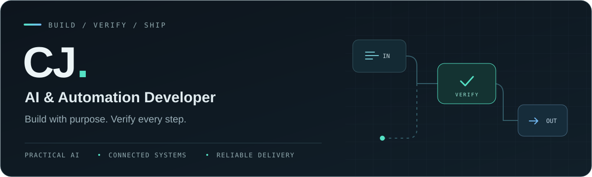

  

  <strong>Websites, apps, and tools that save time.</strong> 
  I help people spend less time on repeated tasks by building software that does the work for them.

  <a href="https://cjtelan.vercel.app/">See my work</a>
  &nbsp; · &nbsp;
  <a href="https://cjtelan.vercel.app/#contact">Get in touch</a>

---

### Hey, I'm CJ

I'm an AI & Automation Developer based in the Philippines. I build websites and apps, connect tools, and use AI to help with everyday work.

I like figuring out why something isn't working and finding a simpler way to do it. I test what I build and check the results before calling it done.

### What I do

- **Build websites and apps** - from the pages people use to the code and databases behind them.
- **Automate repeated tasks** - move information between tools, schedule jobs, and cut down on manual work.
- **Build AI tools** - help with calls, writing, and other tasks, with checks for mistakes.
- **Work with audio and video** - add voiceovers, captions, and checks before a video is ready to share.
- **Make sense of data** - compare records, find missing or incorrect information, and fix calculations.

### Some things I've worked on

- A tool that turns a topic into a video, including the script, voiceover, and quality checks.
- An AI receptionist that collects caller details and passes them to booking and customer records.
- A workload planner that compares agreed work with estimated hours and shows where they don't match.
- Learning activities that work on phones and can be edited in a browser.
- A tool that records a file's digital fingerprint so someone can check which version it belongs to.

I keep client names, code, and business information private.

### Tools I use

Python, JavaScript, SQL, HTML, and CSS. I also use APIs, webhooks, and MCP to connect different tools.

### A bit more about me

I used to play games competitively. Reviewing mistakes and practising until I got better became a habit. I bring that same patience to building and fixing software.

---

  <strong>Got a task you're tired of doing by hand?</strong> 
  <a href="https://cjtelan.vercel.app/#contact">Tell me about it.</a>

