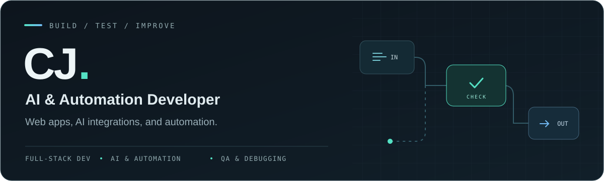

  

  <strong>Full-stack development · AI integrations · Workflow automation</strong> 
  I build web apps, connect APIs, and automate the parts of a job that shouldn't need manual work.

  <a href="https://cjtelan.vercel.app/">Portfolio</a>
  &nbsp; · &nbsp;
  <a href="https://cjtelan.vercel.app/#contact">Get in touch</a>

---

### Hey, I'm CJ

I'm an AI & Automation Developer based in the Philippines. I've worked on SaaS products, web apps, AI features, and automation for day-to-day business operations.

My work covers front-end development, API integrations, databases, and QA. I also spend a lot of time debugging existing systems, tracing data issues, and checking what actually happened during a failed run.

### What I work on

- **Full-stack development** - responsive interfaces, authentication, database queries, and backend functions. I've worked on products from the first build through deployment and production support.
- **Workflow automation** - scheduled jobs, API integrations, webhooks, and multi-step workflows. I add validation, retry limits, and error handling so failures don't leave the whole process stuck.
- **AI integrations** - structured outputs, prompt constraints, tool routing, and stateful agents. I use QA checks and human review where a bad output could cause problems.
- **Voice and video pipelines** - TTS, transcription, captions, and programmatic rendering. This includes pronunciation checks and scoring generated audio before it moves to the next step.
- **Data reconciliation** - comparing records across systems, finding the source of a mismatch, and fixing the data or formulas behind it.

### A few projects

**Automated content production**  
Built a pipeline from topic intake to script generation, verification, TTS, transcription-based QA, and video rendering. Added capped retries and a review path for outputs that didn't pass QA.

**AI receptionist**  
Worked on a SaaS MVP with a voice agent that collected caller details and passed them into scheduling and CRM workflows. Handled missing information, changed requests, and incomplete conversations. Set up QA checks before release.

**Capacity planning and data audits**  
Built a model that compared signed service agreements with job estimates. Traced discrepancies back to source records, audited recurring task templates, and fixed formulas that were leaving rows out of workload totals.

**Browser-based learning tools**  
Built mobile-friendly interactive modules with an editing layer that let users update content directly in the browser.

**Content provenance**  
Built file-hash records, transaction receipt verification, and tools for reviewing the evidence. Kept prepared records separate from confirmed transactions, with duplicate checks and spending limits.

Client names, source code, and operational data stay private.

### Stack and tools

- **Development:** Python, JavaScript, React, HTML, CSS, SQL, PostgreSQL
- **Integrations:** REST APIs, webhooks, MCP, authentication, storage, and serverless functions
- **AI and media:** prompt engineering, structured outputs, agent workflows, TTS, transcription, and FFmpeg
- **QA:** output validation, regression checks, run logs, retry handling, and verifying changes against live records

### Platforms & tools

Platforms I use across development, automation, and project work.

| Area | Platforms and tools |
| :--- | :--- |
| **Workflow automation** |   |
| **Project management** |   |
| **AI integrations and agents** |    |
| **Backend and data** |   |
| **Voice and video** |     |
| **Practice management** |    |
| **Files, email, and spreadsheets** |     |
| **Web publishing** |  |
| **Search integrations** |  |
| **Blockchain and content proofs** |  |

### Outside development

I used to play games competitively. I still have the habit of reviewing what went wrong and working on it until I can do it consistently. Debugging feels pretty familiar in that sense.

---

  <a href="https://cjtelan.vercel.app/">More about my work</a>
  &nbsp; · &nbsp;
  <a href="https://cjtelan.vercel.app/#contact">Contact me</a>

